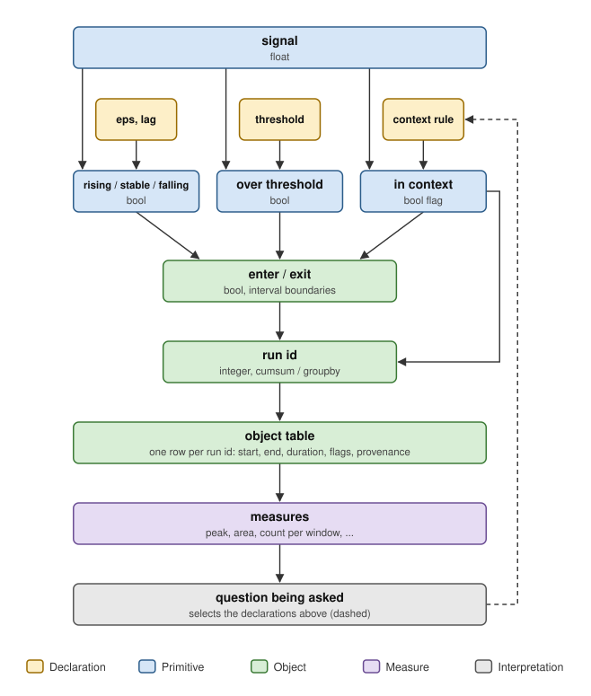

## Framework

Nazia Habib

November 2026

## Introduction

Qualitative simulation (QSIM) was introduced as an inference process for qualitative causal reasoning (Kuipers 1986). It defines a qualitative state as an abstraction of a continuous function, and a behavior as a sequence of these states over time. For an observed, densely sampled physical signal, this definition can describe the signal as a sequence of states and intervals.

Knowledge-based temporal abstraction (KBTA) was introduced as a general method for interpreting time-oriented data with domain-expert knowledge (Shahar 1997). It was developed on clinical data using sparse observations and builds higher-level descriptions from these observations: states, the intervals they form, and patterns of intervals. 

Between them, these frameworks supply two things that this paper builds on: a definition of a qualitative state, and a method for building composable descriptions of observed data from such states. They differ in where the state definitions come from: a model in QSIM, and expert declarations in KBTA. 

That difference runs through the work that followed, which we describe in three stages:

- Declared knowledge. States are qualitatively defined by classification and persistence rules given by experts for a specific domain (Shahar 1994, 1997).
- Cutoffs learned from labels. Cutpoints are chosen to best separate outcome classes, with knowledge-based cutoffs as a comparison baseline (Moskovitch and Shahar 2015). Its experiments cover state abstraction.
- Declarations derived from the signal and recorded. Windows and cutoffs can come from measured properties of the signal, such as its period [cite]. Choices that are not derived, such as an accumulation threshold, can be supplied as explicit variables. Each declaration is recorded with its provenance, and the sensitivity of the result to each chosen parameter can be tested.

Acquiring expert declarations for state classification and persistence is costly [cite]. For densely sampled signals, some of this information can be derived from the signal itself and recorded. Such signals are now routinely collected and openly available [cite], and the derivations are straightforward to code with standard data analysis libraries.

We introduce FeatureGraph to work at this third stage. It is a framework that builds descriptions of time-series signals by composing a small set of primitives into layers: states, then intervals, then measures. Every choice along the way (a threshold, a window, a tolerance) is stated explicitly and stored with the result.

This paper describes FeatureGraph in the vocabulary of the previous two frameworks, so that its constructions can be discussed in terms the field already uses. Section 1 takes the definition of a qualitative state from QSIM. Section 2 maps FeatureGraph onto KBTA, showing where the two overlap and what each lacks relative to the other. FeatureGraph organizes construction into five layers (primitive, declaration, object, measure, scientific interpretation), and we show evidence that declarations derived from a signal can be recorded and tested.

## Section 1: Qualitative simulation

FeatureGraph shares the following definitions with QSIM:

- A qualitative state has two parts: where the value sits relative to named landmark values, and its direction of change (increasing, steady or decreasing) (Kuipers 1986, Definition 2.4). FeatureGraph keeps both parts in two columns: a state such as over threshold, where the declared threshold plays the role of a landmark, and a gradient such as rising, falling or stable.
- A behavior is a sequence of these states over time intervals (Kuipers 1986, Definition 2.7). Kuipers derives behaviors from a model. FeatureGraph builds them from observed data and gives each interval an id.
- States are defined by sign. Kuipers works with the values +, 0 and − [cite]. FeatureGraph's sign tests separate samples into positive, negative and inactive, with the zero case handled explicitly.

QSIM reasons from a model to the behaviors it allows, while FeatureGraph builds states and intervals from observed signals. The two meet at the definition of a state, and this paper does not take the comparison further.

## Section 2: Knowledge-based temporal abstraction

KBTA decomposes the temporal abstraction task into the following subtasks:

- Temporal context restriction. Forming the time intervals (contexts) in which an interpretation applies, so the same value can be read differently depending on context, such as during a treatment.
- Vertical temporal inference. Deriving a higher-level abstraction from values at the same time, such as classifying a value as a state (low, normal, high).
- Horizontal temporal inference. Joining adjacent instances of the same state into one longer interval. 
- Temporal interpolation. Joining state intervals that are separated by a gap, using knowledge of how long the state can be assumed to persist.
- Temporal pattern matching. Recognizing a specified combination of abstractions with temporal constraints as one higher-level interval, such as a rise followed by a fall.

Three of these subtasks overlap with FeatureGraph's object construction:

- Vertical temporal inference, for densely sampled data, is a per-sample comparison, for example x_rising = x.diff() > eps or a threshold test on a value or a contribution. Combining signals at the same time, such as a state that holds only within a context, is the same kind of step.
- Horizontal temporal inference needs no separate decision about which samples belong together. Consecutive samples in the same state already form an interval, and a run id numbers each interval so that its start, end and duration can be queried. Shahar's framework supplies knowledge for joining sparse readings that may be weeks apart. With dense data this is replaced by a fixed rule: adjacent samples in the same state belong to one interval.
- Temporal pattern matching corresponds to fixed object classes such as the breath, defined as a rise followed by a fall.

The other two subtasks are absent for different reasons. 

- Temporal context restriction is not yet implemented. It can be added by computing a boolean flag from another signal or from an annotation and restricting object construction to the flagged intervals. 
- Temporal interpolation is left out by design. In dense data a gap is a stretch of missing samples, and whether a state continues across it depends on the domain. FeatureGraph does not bridge gaps. It records their lengths with each object and leaves the decision to the user, as part of scientific interpretation.

## Section 3: Object types and constructions in FeatureGraph

