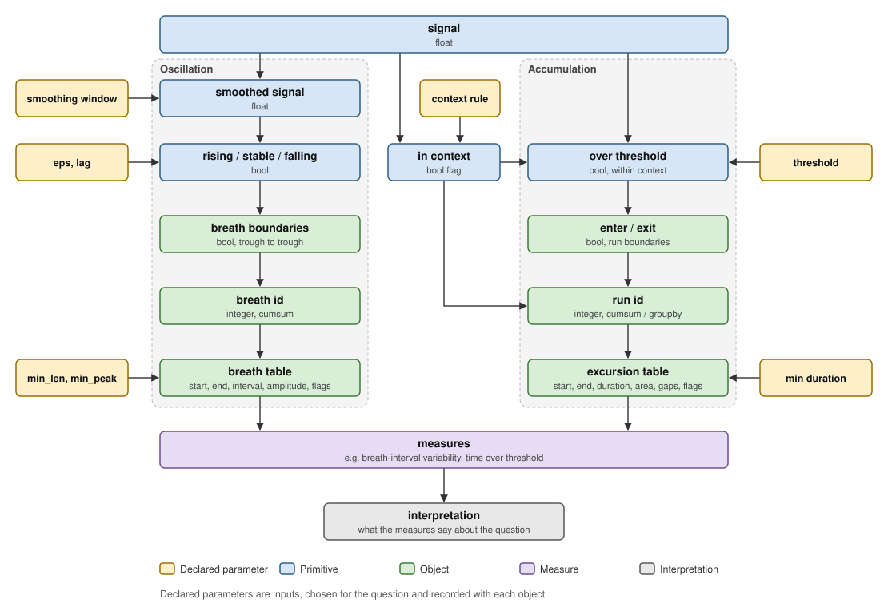

## Framework

Nazia Habib

November 2026

## Introduction

One line of work in temporal abstraction, beginning with Shahar's 1997 framework, can be mapped through three stages:

1. Declared knowledge. States are qualitatively defined by classification and persistence rules given by experts for a specific domain (Shahar 1994 and 1997).
2. Cutoffs learned from labels. Cutpoints are chosen to best separate outcome classes (Moskovitch and Shahar 2015). The method covers state abstraction only in its experiments, not gradients or interpolation. Knowledge-based cutoffs as a comparison baseline.
3. Declarations derived from the signal and recorded. Windows and cutoffs can come from measured properties of the signal such as the period [cite]. Construction choices such as accumulation threshold that are not derived can be supplied as explicit variables. The declaration is recorded with its provenance and sensitivity can be tested for each chosen parameter.

Acquiring expert declarations for state classification and persistence is costly [cite]. For densely sampled signals, much of this information can be derived from the signal itself and recorded. Densely sampled signals are now routinely collected and openly available, and the derivations straightforward to code using standard data analysis libraries. 

This paper maps FeatureGraph, a framework for constructing objects from time-series signals, onto the KBTA framework (Shahar 1997), identifying overlap between the two methods and what each lacks relative to the other. It organizes object construction into five layers (primitive, declaration, object, measure, scientific interpretation), and shows evidence that declarations derived from a signal can be recorded and tested.

## Section 1: Temporal abstraction methods

The Knowledge-Based Temporal Abstraction (KBTA) method is a general problem-solving method for interpreting time-series data with domain-specific knowledge requirements (Shahar 1997). KBTA is composed of five subtasks:

1. Temporal context restriction - Forming the time intervals (contexts) in which an interpretation applies, so the same value can be read differently depending on context. An example is the period of treatment after the administration of a drug.
2. Vertical temporal inference - Deriving a higher-level abstraction from values within a range or truth value, such as classifying a value as a state (low, normal, high).
3. Horizontal temporal inference - Joining adjacent instances of the same state into one longer interval.
4. Temporal interpolation - Joining state intervals that are separated by a gap, using knowledge of how long the state can be assumed to persist.
5. Temporal pattern-matching - Recognizing a specified combination of abstractions with temporal constraints as a single interval, such as a rise followed by a fall.

Four of these (vertical temporal inference, horizontal temporal inference, temporal interpolation, and temporal pattern-matching) overlap fully or partly with FeatureGraph's object-construction methods. The first method in the list, temporal context-restriction, can be implemented using a method discussed below [using a boolean flag to indicate the state of a condition, such as an annotation labeled in the metadata of a time-series]. The fourth, temporal inference, is considered to be scientific interpretation and out of the scope of FeatureGraph.

## Section 2: FeatureGraph mapped to KBTA

## Section 3: Object types and constructions in FeatureGraph

